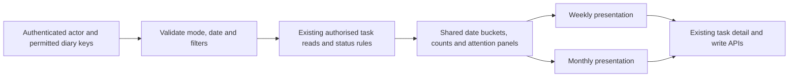

# Weekly and monthly task views

Date: 10 November 2026.

Revision: 11 November 2026. Presentation ownership is inside the Diary package.
Existing personal/manager endpoints now provide List, Day, Week and Month, with
their original shared filters and defaults. A per-user/session, per-role preference
selects the presentation when `view` is absent; an explicit URL value wins. The
host retains its wrapper and access policy, including identifier-free POST task
selection. Separate host calendar URLs/controllers are not required. This revision
supersedes the earlier proposal for different calendar filter defaults below.

Status: DFUT-018 implemented following approval of this design. The original design
is retained below as the rationale. Delivery uses Monday-first weeks, existing
role-specific filter defaults, and one explicitly selected diary in manager mode.
See [Calendar views](../../Diary/CALENDAR_VIEWS.md)
for the implemented API, host setup, settings, and browser behaviour.

## Purpose and scope

Provide two date-based ways to review and progress tasks in instantiated diaries:
**Week** for planning the next few days and **Month** for the wider workload.
Keep **List**, **Day**, **Week**, and **Month** on the same host diary endpoint.
List retains its original all-dates scope; dated presentations show the appropriate
period. Preserve the selected diary and role-specific task filters when switching.

These views use actual diary due dates. They are separate from the template graph,
which explains completion dependencies and date rules without concrete dates for
every template. Navigating a calendar must not create a diary, instantiate a
template, recalculate dates, or change stored task data.

The first implementation covers due dates, not appointment scheduling: tasks
have no start time, duration, or reserved time slot. Do not introduce an hourly
grid, recurring occurrences, drag-to-reschedule, notifications, exports, or live
dependency editing through this feature.

## Shared page structure

The calendar should receive the main screen area. Use one compact header and
toolbar; avoid permanent explanatory panels above the calendar.

```text
My tasks / Selected diary                         [List] [Week] [Month]
[Previous] [Today] [Next]   9–15 November 2026       [Filters] [Help]
                           calendar content
[Late outside this period: 4]   [Date not set: 2]
```

Toolbar actions have stable classes, accessible action names, and the same host
CSS customisation approach as the template navigator. Icon-only controls show
their wording on hover and keyboard focus. Week/Month selection and the period
heading remain readable text. Put filters in a compact popup and guidance in Help.
Closing a popup returns focus to its opener.

Previous and Next move by one week or one calendar month. Today selects the period
containing the diary-local current date. A date picker jumps to a specified date.
Month navigation clamps a retained day to the new month's last valid day rather
than overflowing into the following month. Switching views uses the selected day,
or the current anchor date if no day has been selected.

Navigation and filters use validated query parameters and ordinary GET links.
Refreshing or using browser Back restores the selected period and presentation.
Do not put an entire permitted-diary list or private task names in the URL.

## Week presentation

On a sufficiently wide screen, show seven equal-width day columns. The proposed
default is Monday through Sunday; show weekends rather than silently omitting
them. Highlight Today and include full dates in accessible headings, especially
when the week crosses a month or year boundary.

Each column contains a visible task count and compact task cards. Cards have:

- Task name, with wrapping and access to the full name.
- Diary label when more than one diary is displayed.
- Owner label where useful in manager mode; omit redundant self-owner labels.
- Text status: Ready, Blocked, Completed, and an appropriate date/lateness label.
- An ownership warning for manager-visible orphaned tasks.

Show a bounded preview, initially five cards per day, followed by **View all N
tasks**. Expanding a day opens the shared day panel rather than stretching the
whole week indefinitely. Day limits can be host configurable without changing
which tasks are included in the period or its counts.

There is no invented ordering by time within a day. Use existing orphan priority
for manager-visible orphaned tasks, then open before completed, then task name,
diary key, and entry key for stable ties. Display completion blocking as a status,
not as arrows between calendar columns.

## Month presentation

Show a seven-column calendar with complete weeks, requiring four to six rows
depending on the month and first weekday. Use the same weekday order as Week.
Include the leading and trailing dates needed to complete the grid; distinguish
them with muted date styling while retaining legible task content.

Show up to three task cards in each cell and **+N more** for the remaining matching
tasks. More opens the day panel, not another page with a lost month selection.
Select a date heading to open the same panel even when there are no tasks.
An optional **Open this week** action switches to the corresponding weekly view.

Day cells should stay compact. Longer task names wrap within a bounded card;
the day panel provides the full text. Do not truncate the underlying accessible
name or rely on hover to expose essential task details on touch devices.

The displayed range includes adjacent-month dates. Counts and the attention
panels must use that exact range to avoid counting those visible tasks again.
The heading still identifies the requested month, not the first grid date.

## Day panel and task actions

Week and Month use one accessible day dialog or side panel, headed with the full
date and the number of matching, visible tasks. Show an ordered list of full task
names, diary names, owner labels, status, and links to task details. Paginate a
busy day; keep the calendar selection intact when moving between day pages.

Use the existing task detail route and forms for notes, completion, permitted
date overrides, and ownership recovery. Return to the same calendar period and
filters through a validated local navigation state. A manager's Close all action
retains its existing confirmation, blocker inspection, and concurrency checks.
There is no new one-click completion control on a small calendar card initially.

After a successful write, reload the relevant calendar data. Keep the selected
date; update affected day counts and attention panels. If a permission, revision,
or membership check fails, show the existing error and refresh the authorised
task state. Do not show optimistic completion that the server has rejected.

## Personal and manager modes

| Mode | Default diary scope | Task selection |
| --- | --- | --- |
| Personal | All diaries permitted by the host, or an explicitly selected permitted diary. | Open tasks assigned to the current person or their ownership groups. Whole-team tasks are opt-in, consistent with My Diary. |
| Manager | One explicitly selected permitted diary. | All tasks visible to that manager in the selected diary, with open tasks initially selected. |

Manager multi-diary aggregation can follow later if needed; it must be an explicit
selection of host-authorised diaries. A calendar date or task UUID never grants
access to a diary. Selecting Manager mode requires manager permission.

Personal aggregation follows the existing open-diary selection. An explicitly
selected closed diary in Manager mode shows an archived banner and preserves its
unfinished tasks and optional completion history. Enforce existing closed-diary
write restrictions; notes remain available where the current API permits them.
Do not use the empty result from `active_tasks()` on a closed diary as proof that
the diary has no stored unfinished tasks.

Recommended calendar filters are task-name/description search, show completed,
show blocked, whole-team inclusion in Personal mode, and owner selection in
Manager mode. Show active filters and offer Reset filters. Counts, previews,
expanded days, and attention panels apply the same selection.

The implemented shared-filter rule preserves personal ready-only defaults in
all presentations. Explicit personal status selections and Show blocked apply
identically in List, Day, Week and Month. Manager completion/blocked/late filters
also stay identical when the presentation changes.

## Late and undated work

A future calendar period must not conceal unfinished work from earlier dates.
Provide two collapsed attention panels outside the grid:

- **Late outside this period**: matching open tasks marked late by the existing
  status rules whose due dates are outside the displayed grid range.
- **Date not set**: matching open tasks without a calculable due date.

Each panel shows an authorised count and a paginated list when expanded. These
are not extra calendar occurrences. Do not repeat a task in an attention panel
when it already appears on a visible grid date. Task counts count records, not
group members, predecessor links, or template occurrences.

Preserve the current `late` rule: open tasks due **on or before** today are marked
late. A due-today task can additionally display **Due today** rather than implying
that an entire day has already elapsed. Completed tasks do not appear in the
attention panels. When completed tasks are enabled, place them on their recorded
completion due date, not the date on which the completion action happened.

## Date semantics

All boundaries are date-only values in the effective Diary time zone:
`DIARY_TIME_ZONE`, otherwise Django's `TIME_ZONE`. Calculate Today once per
request and use it throughout task status and range calculations.

Internally use a half-open interval **[start, end)**. A week spans seven dates;
a monthly grid spans its complete calendar weeks. A task due on start is included;
a task due on end belongs to the next interval. Query dates directly instead of
converting local dates to UTC midnight timestamps. Leap days, daylight-saving
changes, and year boundaries must not add or remove task occurrences.

| Task date rule | Calendar placement |
| --- | --- |
| One-time or annual | The resolved diary due date. An annual rule supplies one task occurrence per diary, not a repeating annual event. |
| Milestone-relative | The current effective diary task due date under the existing date rules. |
| Task-relative | The initialized snapshot plus any explicit override already allowed by the API. Late completion of a source does not move it. |
| Zero offset | The same calendar date as the source; stack separate task cards in that day. |
| Missing date | Date not set panel, with no fabricated calendar date. |
| Completed | Recorded `completed_due_date`. |

Milestones are not task cards in this first design. A later option could display
authorised diary milestone dates as distinct markers; that is separate from the
template graph's milestone diamonds and needs its own selection/privacy policy.

## Narrow screens and accessibility

At narrow widths, switch to a chronological agenda with full-width day sections
instead of compressing seven unreadable columns. Week lists its seven dates.
Month shows dated summaries and expandable day lists, preserving the same range,
counts, filters, and selected date. Clearly label this as the month agenda.

Provide semantic day headings, normal buttons and links, visible focus, full
accessible names, and status text in addition to colour. A desktop month table
can use column headers and date headings without introducing a complex custom
ARIA grid. Keep tab order chronological. Dialogs support Escape and restore focus;
touch users can open all information without hover. Navigation also works without
JavaScript through server-rendered Week/Month or agenda pages and day links.

Keep the calendar panel within the host's available width. Large task counts
must not expand the page horizontally. Reuse Diary colours and provide namespaced
classes such as `diary-task-calendar`, `diary-calendar-toolbar`,
`diary-calendar-day`, `diary-calendar-task`, and `diary-calendar-day-dialog`.
Allow hosts to override day height, preview limits, spacing, and toolbar graphics.

## API and server integration

Build one shared period-selection service, then render both views from its
results. Do not implement independent calendar permission, readiness, or due-date
calculations in JavaScript.



Proposed public read service: `DiaryAPI.task_period(...)`, accepting `view`,
`anchor_date`, optional `diary_key`, `mode`, and validated filter options. Concrete
names should be agreed during implementation. Its contract should return:

- Requested view/anchor, selected date, primary period and displayed range bounds,
  local Today, time zone, and weekday order.
- Day summaries with date, full matching count, bounded task preview, and a way to
  fetch the remaining tasks for that authorised date.
- Separately paginated late-outside-range and undated summaries.
- Explicit `(diary_key, entry_key)` identity on every task. The same template key
  in two diaries represents two different task records and must never be deduplicated.

Reuse `DiaryInstance.read()`, `active_tasks()`, `personal_tasks()`, and existing
visibility/status helpers as the source of truth. Completed-task selection needs
a path through authorised reads, because `active_tasks()` excludes completed work.
Compute readiness and blocked-late state from the full authorised diary graph
before selecting the period: a predecessor outside the week may still block a
visible task. Never expose a private predecessor's UUID, name, date, or count.

Add host-extensible class-based page/data views with the current trusted scope
hooks, private/no-store responses, and shared context/fragment conventions.
Validate view values, ISO dates, filter choices, and pagination. Derive range bounds
on the server from the requested period; cap day-page size. Prefer Previous/Next
over an unbounded client-supplied date range. Do not store task data in localStorage.

For initial delivery, reuse existing storage with no required data migration.
Use fixtures representing busy months to check query counts and response size.
Period totals and day counts must cover the full matching result, not just previews
or the first result page. Avoid per-day and per-card queries. If existing task reads
prove expensive, optimise shared selection while preserving its privacy and
out-of-period predecessor semantics before adding caching.

## Delivery and acceptance

1. Implement and verify the shared period/date/filter contract using existing
   authorised task reads and scoped task identities.
2. Add the weekly page, mobile agenda, day expansion, and task-detail return flow.
3. Add the month grid, adjacent dates, overflow controls, and month agenda.
4. Add filter/help dialogs, host CSS hooks, no-JavaScript fallbacks, and guides.

Required verification includes:

- Week/month transitions, leap February, four/five/six-row months, time-zone Today,
  daylight-saving transitions, and tasks exactly on start/end boundaries.
- Personal, role, whole-team and manager selection; permission changes; closed
  diaries; private predecessor masking; counts that do not leak hidden tasks.
- Reused task UUIDs across two diaries; exactly one occurrence per matching diary
  task; zero/negative offsets; fixed task-relative dates after late completion.
- Completed-task history, late work outside the displayed interval, missing dates,
  overflow and day pagination, and consistent counts under every filter.
- Busy desktop and narrow layouts, keyboard/touch use, dialog focus, browser Back,
  filter reset, task write success/failure, and host styling overrides.

Implementation uses configurable weekday/preview limits, Monday-first and
existing role filter defaults, and single-diary manager scope. Multi-diary manager
aggregation and milestone markers remain future extensions. This delivery does
not retroactively make a month display a V1 completion condition.

## Related records

- [DFUT-018 and the feature backlog](../../TODO.md#diary-feature-backlog).
- [DFUT-003 date-window filtering](diary-v1-remaining-work.md#dfut-003-future-date-window-filtering): share boundary/filter semantics, but retain the calendar's previous/past-period navigation rather than restricting it to future work.
- [Original first-release page scope](event-calendar.md#6-page-design): date-ordered lists remain the implemented baseline.
- [Task identity and signals](../../Diary/README.md#task-change-signals).
